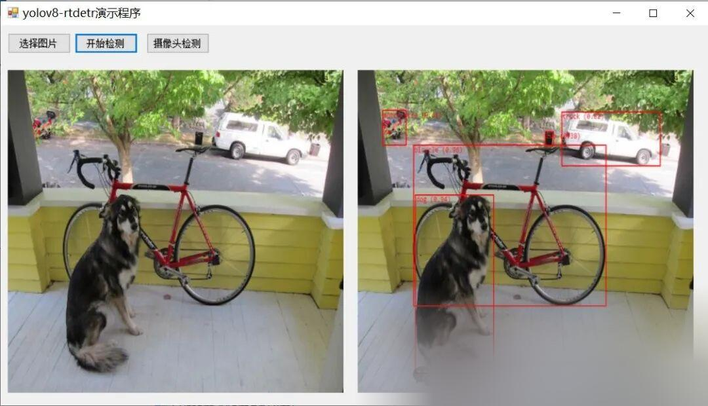

# [C#] Winform deployment of official YOLOv8-RTDet object detection ONNX model

[Official Framework Address]

https://github.com/ultralytics/ultralytics
[Algorithm Introduction]

RTDETR, abbreviated as "Real-Time Detection with Transformer for Object Tracking and Detection", is an algorithm based on the Transformer structure for real-time object detection and tracking. It has wide applications in the field of object detection and tracking, especially in scenarios requiring real-time processing and high accuracy.

The main characteristic of RTDETR algorithm is its adoption of Transformer structure, which has achieved great success in the field of natural language processing. By utilizing self-attention mechanism and multi-head attention mechanism, RTDETR can effectively capture the context information between targets in images, thereby improving the accuracy of detection and tracking.

Compared with traditional target detection and tracking algorithms, RTDETR has higher accuracy and real-time performance. It adopts a novel integrated design of detection and tracking, unifying the task of target detection and tracking into one model for processing, reducing computational load and parameter count, thereby enhancing operational speed. Additionally, RTDETR employs learnable anchor box design and trajectory inference mechanism to further improve the accuracy of target detection and tracking.

In practical applications, RTDETR can be applied to various scenarios such as intelligent surveillance, autonomous driving, and drones. In these scenarios, real-timeness and accuracy are crucial, and the RTDETR algorithm precisely meets these requirements. For instance, in the context of intelligent surveillance, RTDETR can detect and track abnormal behavior or targets in surveillance footage in real time, providing timely warnings for safety precautions; in the context of autonomous driving, RTDETR can assist vehicles in achieving real-time perception and decision-making, enhancing the safety and stability of their operations.

In summary, the RTDETR algorithm is a real-time target detection and tracking algorithm based on Transformer structure, which has high accuracy and real-time performance. It can be widely applied in various scenarios and provides an effective solution for real-time processing and high accuracy requirements.

[Effect Display]



[Implementation of Partial Code]

-
-
-
-
-
-
-
-
-
-
-
-
-
-
-
-
-
-
-
-
-
-
-
-
-
-
-
-
-
-
-
-
-
-
-
-
-
-
-
-
-
-
-
-
-
-
-
-
-
-
-
-
-
-
-
-
-
-
-
-
-
-
-
-
-
-
-
-
-
-
-
-
-
-
-
-
-
-
-
-
-
-
-
-
-
-
-
-
-
-
-
-
-
-
-
-
-
-

```
using System;
```

[Video demonstration]

https://www.bilibili.com/video/BV11a4y1C72W/?vd_source=989ae2b903ea1b5acebbe2c4c4a635ee
[Test Environment]

vs2019,netframework4.7.2,onnxruntime1.16.3


## Payment

Here is a pay link on Stripe ( https://buy.stripe.com/3cs8yP7sY87d0vu9AB ). Please contact me lonlonago@foxmail.com after funding $89, and I will send you a complete data files , thank you!


